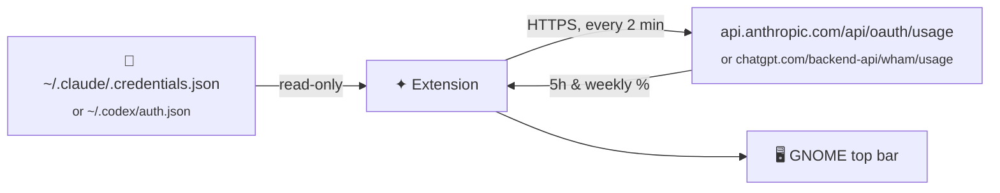

<div align="center">

# ✦ Claude Usage for GNOME

**Your Claude Code or ChatGPT/Codex subscription limits, live in the Ubuntu top bar.**




</div>

---

Ever been cut off mid-task by *"You've reached your usage limit"*? This small GNOME Shell extension shows your **5-hour session** and **weekly** usage as two slim progress bars next to the clock, so you see a limit coming instead of running into it.

> [!NOTE]
> This is an **unofficial, community project**. It is not affiliated with, endorsed by, or supported by Anthropic.

## ✨ Features

| | |
|---|---|
| 🔀 **Claude or ChatGPT** | Pick Claude Code or Codex (ChatGPT plan) from the drop-down. Your choice is remembered. |
| 👤 **Account name** | The username of the logged-in account sits left of the logo, so you know whose limits you're seeing. |
| 📊 **Two stacked mini bars** | Session (5h) on top, weekly below. Compact enough to sit beside the tray icons. |
| 🎨 **Color-coded** | Green → amber → red as you approach the limit. |
| 🎞️ **Smooth animation** | Bars glide to their new value and colors cross-fade. |
| ⏱️ **Reset countdowns** | Click the indicator: *"resets in 2h 14m"* or *"resets Fri 19:00"*. |
| 🔄 **Auto-refresh** | Updates every 2 minutes, or on demand with **⟳ Refresh**. |
| 🪶 **Zero dependencies** | ~250 lines of plain GJS. Nothing to install besides the extension itself. |

<div align="center">

</div>

## 🔍 How it works



When you log in to [Claude Code](https://docs.claude.com/en/docs/claude-code/overview), it stores an OAuth token on your machine. The extension reads that token and asks Anthropic's servers for the same usage numbers that Claude Code's `/usage` command shows.

With **ChatGPT** selected it does the same with the token [Codex](https://github.com/openai/codex) saves when you sign in with ChatGPT, showing the limits Codex's `/status` shows.

### 🔒 Privacy & security

- **You don't enter any credentials.** The extension reuses the login Claude Code or Codex already saved.
- **Your token only goes to its own provider** (`api.anthropic.com` or `chatgpt.com`), the same server the CLI talks to. Only the selected provider is contacted. No analytics or third-party services.
- **Read-only.** The extension never writes to, refreshes, or copies your credentials files, so it can't break your CLI login.
- **Account name stays local.** It's read from Claude Code's `~/.claude.json` or the Codex login's ID token, and only shown in your top bar.
- **Nothing is logged.** The only thing stored is your provider choice, in `~/.config/claude-usage-provider`.
- **Small and auditable.** All the logic lives in [`usage.js`](claude-usage@local/usage.js) and [`extension.js`](claude-usage@local/extension.js).

> [!WARNING]
> The usage endpoints are **undocumented** and may change without notice. If that happens the indicator shows ⚠ until the extension is updated. It can't affect your account.

## 📦 Requirements

- **GNOME Shell 46, 47 or 48** (Ubuntu 24.04 and later)
- **[Claude Code](https://docs.claude.com/en/docs/claude-code/overview)** logged in with a **Pro or Max subscription**, and/or **[Codex](https://github.com/openai/codex)** signed in with a **ChatGPT plan**. API-key users have no subscription limits to show.

## 🚀 Installation

**Quickest:** download `claude-usage@local.zip` from the [latest release](https://github.com/maateusjo/claude-progress-bar/releases/latest), run `gnome-extensions install --force claude-usage@local.zip`, then continue at step 3.

**From source:**

```bash
# 1. Get the code
git clone https://github.com/maateusjo/claude-progress-bar.git
cd claude-progress-bar

# 2. Install it for your user
mkdir -p ~/.local/share/gnome-shell/extensions
cp -r claude-usage@local ~/.local/share/gnome-shell/extensions/
```

**3. Restart GNOME Shell** so it detects the new extension:

- **Wayland** (Ubuntu's default): log out and log back in.
- **X11:** press <kbd>Alt</kbd>+<kbd>F2</kbd>, type `r`, press <kbd>Enter</kbd>.

```bash
# 4. Enable it
gnome-extensions enable claude-usage@local
```

The ✦ indicator appears in the top bar. Click it for details. 🎉

<details>
<summary><b>Updating</b></summary>

```bash
cd claude-progress-bar && git pull
cp -r claude-usage@local ~/.local/share/gnome-shell/extensions/
```
Then log out and back in (Wayland) or restart the shell (X11).
</details>

<details>
<summary><b>Uninstalling</b></summary>

```bash
gnome-extensions disable claude-usage@local
rm -rf ~/.local/share/gnome-shell/extensions/claude-usage@local
```
</details>

## 🩺 Troubleshooting

| Symptom | Fix |
|---|---|
| **⚠ in the top bar, menu says "Token expired?"** | The CLI renews its token only while running. Open Claude Code (or Codex) once; the bar recovers on the next refresh. |
| **⚠ with `HTTP 401` / `403`** | Run `claude` and log in again with `/login` (Codex: `codex login`). |
| **⚠ "Not logged in to Codex with ChatGPT"** | Run `codex login` and sign in with ChatGPT, not an API key. |
| **⚠ "Not logged in to Claude Code with a subscription"** | You're logged in with an API key, or not at all. Run `claude`, then `/login` with your Pro/Max account. |
| **⚠ with a file error** | The selected CLI isn't logged in on this machine (`~/.claude/.credentials.json` or `~/.codex/auth.json` is missing). |
| **Indicator doesn't appear** | Check `gnome-extensions info claude-usage@local`. It should say `State: ACTIVE`. |
| **Something else** | Watch the shell log: `journalctl -f -o cat /usr/bin/gnome-shell` |

## 🎨 Customizing

All sizes and colors live in [`stylesheet.css`](claude-usage@local/stylesheet.css):

```css
.cu-low  { background-color: #57e389; }   /* under 50% */
.cu-mid  { background-color: #f8c251; }   /* 50–79%   */
.cu-high { background-color: #ff6b6b; }   /* 80%+     */
.cu-icon { font-size: 16pt; }             /* top-bar logo size */
```

> [!TIP]
> If you change a track `width` in the CSS, update `PANEL_WIDTH` / `MENU_WIDTH` at the top of `extension.js` to match.

## 🤝 Contributing

Contributions are welcome: bug reports, ideas and pull requests alike.

### Development setup

Symlink the extension instead of copying it, so your edits are picked up on the next shell restart:

```bash
git clone https://github.com/maateusjo/claude-progress-bar.git
cd claude-progress-bar
ln -sfn "$PWD/claude-usage@local" ~/.local/share/gnome-shell/extensions/claude-usage@local
```

### Testing

```bash
# Unit checks + one live fetch per logged-in CLI
gjs -m test.js

# Try the extension in a nested GNOME Shell window, without logging out
dbus-run-session -- gnome-shell --nested --wayland   # GNOME 46–47
dbus-run-session -- gnome-shell --devkit             # GNOME 48+
```

### Project layout

```
claude-usage@local/
├── metadata.json    # extension id and supported GNOME versions
├── extension.js     # top-bar widget, drop-down menu, refresh timer
├── usage.js         # API call + pure helpers (pct, level, until), testable outside the shell
└── stylesheet.css   # all sizes and colors
docs/                # README illustrations
test.js              # self-checks, run with gjs
```

### Guidelines

1. **Open an issue first** for anything bigger than a small fix, so we can agree on the approach.
2. **Keep it dependency-free.** GJS and the GNOME platform libraries only.
3. **Put logic in `usage.js`** as pure functions and add a check for it in `test.js`.
4. **Run `gjs -m test.js`** and try your change in a nested shell before opening a PR.
5. **Never commit credentials, tokens or real API responses.** Redact anything personal in screenshots and logs.
6. **Keep the extension read-only** with respect to `~/.claude/` and `~/.codex/`.

### Ideas for contributions

- 🔔 Desktop notification at 80% / 95%
- 📍 "Pace" marker showing how much of the window has elapsed
- 🌗 Light-theme colors
- 🌍 Translations

## 📄 License

[MIT](LICENSE). Do what you like, no warranty.

<div align="center"><sub>Made for people who'd rather see the wall coming. ✦</sub></div>
